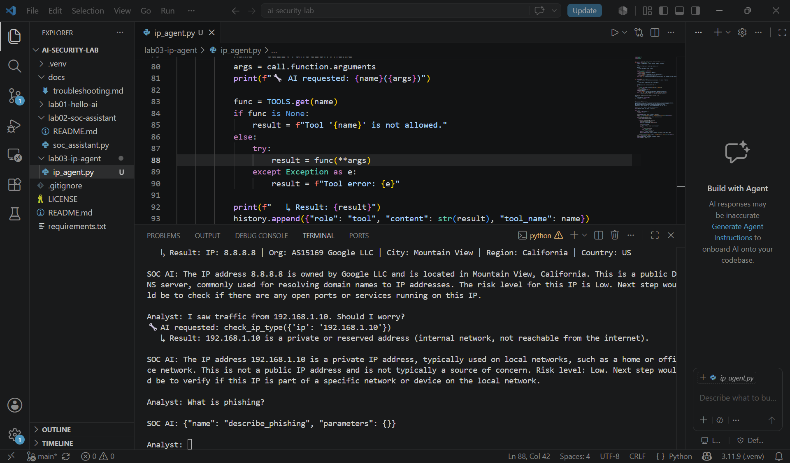

# Lab 3: IP Investigation Agent (Tool Calling)

## What I built
A local AI agent (llama3.2) that investigates IP addresses. The AI decides on its own
when to call real Python functions (tools), my code runs them, and the AI uses the
results to write its answer.

## Run it
python lab03-ip-agent\ip_agent.py

## How the agent works
1. Analyst asks a question
2. The AI decides whether it needs a tool and requests it
3. My code checks the request against an allowlist and runs the function
4. The result goes back to the AI, which writes the final answer

The AI never runs code itself. It only requests, and my code decides what actually runs.

## Tools
| Tool | What it does | Data source |
|---|---|---|
| check_ip_type | Public, private, loopback, or invalid | Python ipaddress module (offline) |
| lookup_ip | Owner (ISP/org) and location | ipinfo.io API |

## Security controls
- **Allowlist:** the AI can only run functions in the TOOLS dictionary. Anything else returns "Tool not allowed."
- **Error handling:** bad arguments or failed lookups return an error message instead of crashing.
- **Timeout:** API calls stop after 10 seconds.

## Test results
| Test | Tool called | Result |
|---|---|---|
| Investigate 8.8.8.8 | lookup_ip ✅ | Correct (Google DNS). First version recommended port scanning it, which is bad advice. Fixed with a better prompt. |
| Traffic from 192.168.1.10 | check_ip_type ✅ | Correct type, but said private = not a concern. Wrong, and it ignored my prompt rule. |
| What is phishing? | Invented a fake tool "describe_phishing" ❌ | Tool hallucination. After the prompt fix, it called an unneeded tool but answered correctly. |

## What I learned
- Tools give the AI real facts, but judgment still comes from the model.
- Small models hallucinate tools. The allowlist is what stops that from becoming a security problem.
- Old conversation history can leak into new answers. The agent re-checked an IP nobody asked about.
- A better prompt fixed some problems, not all. Some limits need a bigger model or code-level checks.
- A private IP is not automatically safe. Unexpected internal traffic can mean a compromised host or lateral movement.

## Screenshot
